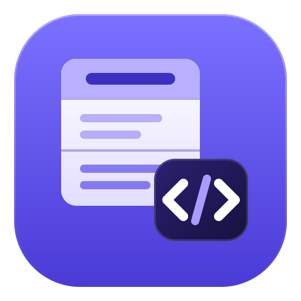

# Logiq Studio

An IDE for Java, HTML, CSS and JavaScript for Windows, built with Tauri 2, Rust and React in the Graphiq design
language shared with Graphiq, Inq, Magiq, Disq and Uplinq Studio. *Logiq* as in logic: write the code, and see
its structure as a UML class diagram that redraws itself while you type, as the Röhner Java-Editor does.



## What it does

- **Editor**: CodeMirror 6 with syntax colouring for Java, HTML, CSS, JavaScript, TypeScript, JSON and Markdown,
  bracket matching, folding, multiple cursors, find and replace, go to line, comment toggling, re-indenting,
  live syntax errors, Java completion (keywords, snippets such as `sout`/`main`/`fori`, your own classes and
  their members, common library classes), go to definition (`F12`), find usages, rename symbol (`F2`),
  formatting with Prettier (Java too), Emmet, colour swatches, breadcrumbs, sticky scroll and a split view.
- **UML class diagram** from the Java code in the folder: classes, abstract classes, interfaces, enums and
  records with attributes and methods in UML notation (visibility `+ - # ~`, static underlined, abstract in
  italics); generalisation, realisation, association with role names and multiplicities, dependency and nesting.
  Boxes can be dragged (the layout is saved in `.logiq/uml.json`), the diagram can be arranged automatically,
  filtered by folder, zoomed, printed, and exported as SVG, PNG, PlantUML or Mermaid. Double-click a class or member
  to jump to its code. **Edit the code from the diagram**: create classes with a wizard, add, change and delete
  attributes, methods and constructors, draw inheritance and associations, add notes.
- **Object bench**: create objects from the diagram's classes, call their methods with arguments, and watch their
  fields change, drawn as UML objects.
- **Run**: `F5` compiles every `.java` file with `javac` into `out/` and runs the main class; output streams into
  the panel, and keyboard input (for `Scanner`) can be typed while the program runs. Compiler errors are listed
  under Problems and underlined in the editor. JavaScript files run with Node.js; HTML pages show in the live
  preview, which reloads on save.
- **Debugger**: breakpoints, stepping, call stack, variables and watches; record a run as a UML sequence diagram.
- **Java tools**: run configurations (main class, arguments, JVM options), JShell, JUnit 5 tests with a results
  tree, runnable JAR export, Javadoc, a library manager for `lib/`.
- **Workspace**: explorer with create, rename, delete (to the Recycle Bin), find in files (text, whole word,
  case, regex), outline of the active Java file, quick open (`Ctrl+P`), command palette (`Ctrl+Shift+P`), and the
  folder is watched so changes made elsewhere show up at once. Drag files to move them, cut, copy, paste and
  duplicate them; unsaved changes and open tabs survive a restart. Live Markdown preview.
- **Languages**: English and German.

## Develop

```bash
npm install
npm run tauri dev
```

Work on the interface in a browser against an in-memory stand-in for the native side (http://localhost:1430):

```bash
npm run dev
```

Tests:

```bash
npm test
```

```bash
cd src-tauri && cargo test
```

A JDK (Java 17 or newer recommended) must be installed for compiling and running Java. Logiq Studio finds it
through `JAVA_HOME`, `PATH` and the usual install folders, or it can be chosen in Settings.

See [ROADMAP.md](ROADMAP.md) for what is done and what comes next.
